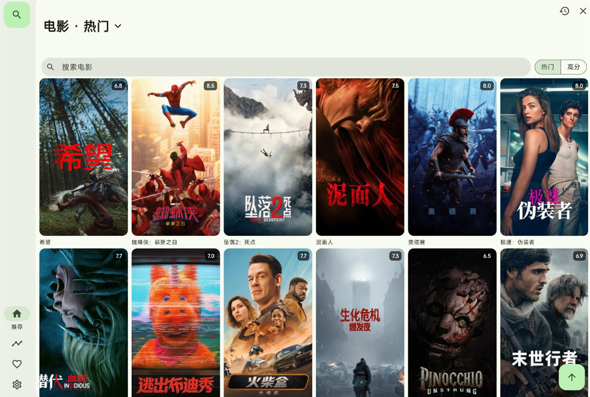
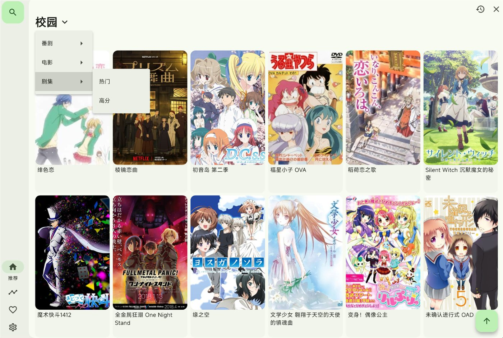
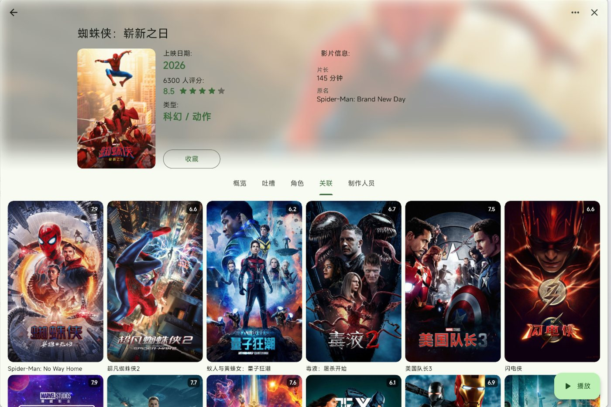
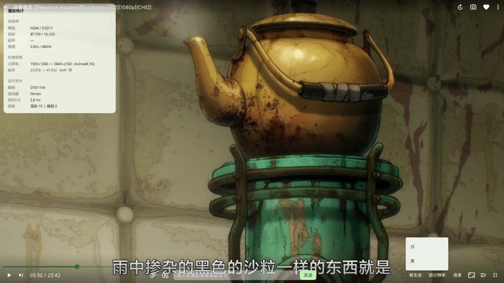
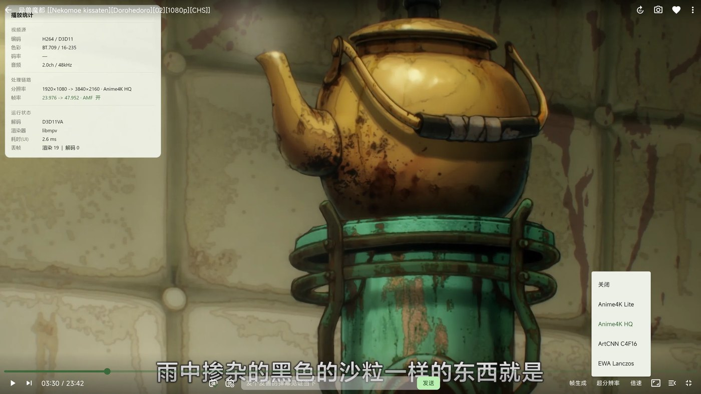

<div align="center">

# Kura

<sub>一站式观影客户端 · 番剧 / 电影 / 剧集</sub>

<sub>基于 <a href="https://github.com/Predidit/Kazumi">Predidit/Kazumi</a> 构建 · GPL-3.0</sub>



<sub>影视板块 · 电影海报墙</sub>

</div>

---

Kura 是一个把**番剧、电影、剧集**放在一起看的桌面播放器。

它以 [Kazumi](https://github.com/Predidit/Kazumi) 为基础：保留它原有的规则（源）体系，把番剧之外的内容也接了进来，并在播放端加了插帧、超分和运行数据面板。目标是：**片子在哪儿都行，看的时候体验统一。**

目前面向 Windows，播放内核为 mpv（通过 media_kit）。

## 和官方 Kazumi 的差别

| 方面 | 官方 Kazumi | Kura |
| :--- | :--- | :--- |
| 内容类型 | 只有番剧（Bangumi） | 番剧 + **电影 / 剧集**（TMDB） |
| 影视详情 | 无 | 海报墙、评分、简介、标签、**演职员**、**关联作品** |
| 搜索 | 只搜番剧 | **一个框搜三种**，分区展示 |
| 影视播放 | 无 | 接规则（源）体系，选源后进内置播放器 |
| 影视记录 | 无 | 独立观看记录，不混进番剧历史 |
| 超分 | Anime4K 两档 | 四档：Anime4K Lite / Anime4K HQ / ArtCNN C4F16 / EWA Lanczos |
| 插帧 | 无 | **AMD 硬件插帧**（AMF），播放器内开关，状态记忆 |
| 运行数据 | 无 | 播放统计浮层：帧率链路、分辨率、色彩、解码、丢帧 |

## 影视板块

列表分「电影」「剧集」两个子页，热门 / 高分可切换，支持搜索与滚动分页。数据来自 TMDB，中文标题与简介。



详情页与番剧详情页结构一致：模糊背景、信息卡、Tab 分页。Tab 包含概览、剧集（剧集类才有）、吐槽、角色、关联、制作人员。



- **演职员**：角色（含饰演角色）与制作人员（导演、编剧、摄影等）
- **关联**：TMDB 推荐作品，可继续点进去
- **标签**：类型 + TMDB 关键词合并，超出折叠
- **播放**：点「开始观看」调用已导入的规则搜索片名，选定来源后进入内置播放器
- **记录**：看过的影视单独存一份，详情页显示「上次看到 第 N 集 · 时间」

影视条目用负数 id 与番剧隔离，不污染番剧的收藏、进度和跨端同步。

## 统一搜索

一个输入框，三个数据源并行：

```
关键词
├── 番剧  → Bangumi
├── 电影  → TMDB
└── 剧集  → TMDB
```

结果分三区展示，卡片规格与番剧搜索结果一致。

## 播放增强

### 帧生成（AMD 硬件插帧）

走 AMD 显卡的 AMF 单元，播放器内一键开关，切换有气泡提示，状态写入设置、重启保持。



### 超分四档

按内容类型选算法，切换时有提示：

| 档位 | 算法 | 适合 |
| :--- | :--- | :--- |
| Anime4K Lite | Restore_CNN_M + Upscale_CNN_x2_M | 2D 动画，开销低 |
| Anime4K HQ | Restore_CNN_VL + Upscale_CNN_x2_VL | 2D 动画，画质优先 |
| ArtCNN C4F16 | 通用卷积超分 | 3D 国漫、写实向 |
| EWA Lanczos | 不加载 shader，只做高质量缩放 | 真人电影、纪录片 |

### 播放统计浮层

按 `I` 打开，显示源帧率与输出帧率、分辨率链路、色彩矩阵与范围、解码方式、渲染器、丢帧数。数值取自播放器实时上报。



插帧依赖 Windows 的 D3D11 渲染管线与 AMD 显卡，其他平台自动跳过；超分与统计浮层不受平台限制。

## 使用前提

| 项目 | 要求 |
| :--- | :--- |
| 系统 | Windows（插帧需要 D3D11，其余功能跨平台） |
| 显卡 | 插帧目前仅支持 **AMD**；NVIDIA 方案在计划中 |
| 网络 | `api.bgm.tv` 与 TMDB 接口在国内需要代理 |
| 凭证 | 弹弹play（弹幕）与 TMDB（影视）都需要自行申请 |

## 凭证

仓库里没有任何密钥，编译时注入：

```json
// local/credentials.json（.gitignore 已覆盖）
{
  "DANDANAPI_APPID": "弹弹play AppId",
  "DANDANAPI_KEY": "弹弹play AppSecret",
  "TMDB_API_KEY": "TMDB API Key 或 Read Access Token"
}
```

```powershell
flutter build windows --release --dart-define-from-file=local/credentials.json
```

没有凭证也能编译，只是弹幕和影视不可用。

## 编译

工具链、`ech_http` 在 MSVC 下的编译问题、回滚方式，见 [SELF-BUILD.md](./SELF-BUILD.md)。一键构建用 `build.ps1`。

## 接下来的计划

- **NVIDIA 的插帧方案**：目前只走 AMD AMF，后续评估 N 卡可用的实现
- **更多超分方案**：ArtCNN 其他强度、RAVU 等
- **移动端**：apk 优先；ipa 需要 macOS 环境编译。移动端无法做硬件插帧，计划以轻量超分 + 帧混合替代
- **细节打磨**：影视收藏、来源面板检索词优化、统计浮层数值继续贴近实测

## 关于上游

本项目基于 [**Predidit/Kazumi**](https://github.com/Predidit/Kazumi) 构建，遵循 GPL-3.0，保留原项目的版权声明与许可证（见 [LICENSE](./LICENSE)）。

规则语法、支持平台、常见问题等文档请直接看上游仓库：
<https://github.com/Predidit/Kazumi>

播放内核为 mpv / libmpv（通过 media_kit）；影视元数据来自 [TMDB](https://www.themoviedb.org/)；弹幕来自 [弹弹play](https://www.dandanplay.com/)。

---

<sub>This product uses the TMDB API but is not endorsed or certified by TMDB.</sub>
